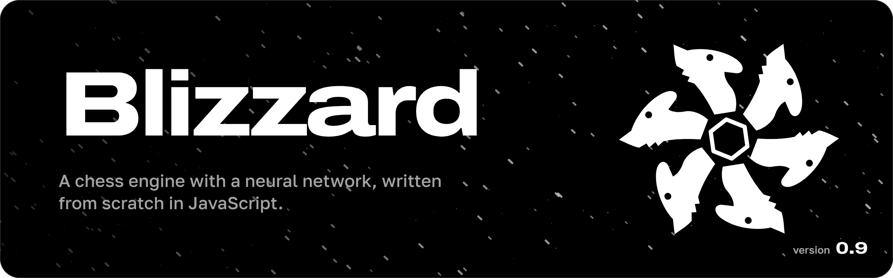
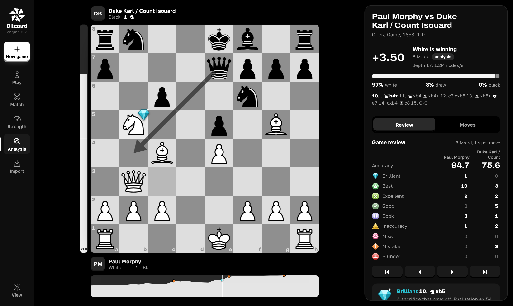
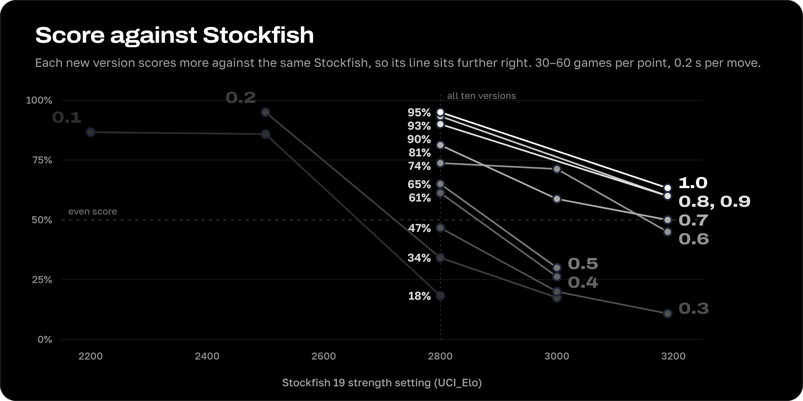
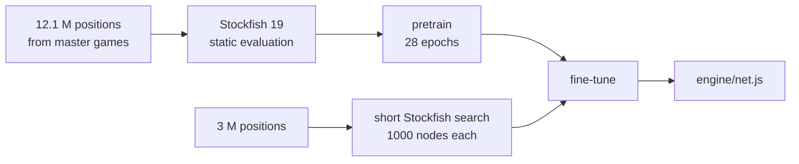

<p align="center">
  
</p>

<p align="center">
  <a href="../../releases/latest"></a>
  
  
  
</p>

<p align="center">
  <a href="../../releases/latest"><b>Download</b></a>
  &emsp;&emsp;
  <a href="https://sacon1s.github.io/blizzard/play.html"><b>Play in the browser</b></a>
  &emsp;&emsp;
  <a href="#strength"><b>Strength</b></a>
  &emsp;&emsp;
  <a href="#how-it-works"><b>How it works</b></a>
</p>

<br>

Blizzard is a chess engine written from scratch in JavaScript, with no third-party code. It plugs into
Arena, Cute Chess, En Croissant and any other program that speaks UCI, the same way Stockfish does.
Or you can play it in the browser, at ten levels from beginner to full strength, and let it review
your games from chess.com and lichess.

Positions are evaluated by a small neural network that knows where each king stands. It was trained
on 12 million positions from master games evaluated by Stockfish 19, then fine-tuned on 3 million
positions scored by a short Stockfish search.

<p align="center">
  
</p>

## Download

| | File | Size | What you need |
|---|---|---|---|
| **Windows** | [`blizzard-0.3-windows.zip`](../../releases/latest) | 33 MB | Windows 10 or 11, 64-bit. Nothing to install. |
| **macOS, Linux, others** | [`blizzard-0.3-universal.zip`](../../releases/latest) | 1.2 MB | [Node.js](https://nodejs.org) 18 or newer |

Unpack the archive into any folder. Blizzard has no board of its own: double-clicking `blizzard.exe`
only opens a console window where the engine waits for commands. Add it to a chess program instead.

> [!NOTE]
> The `.exe` has no paid code-signing certificate, so Windows SmartScreen may say "Unknown publisher"
> on first launch. Click **More info**, then **Run anyway**.

### Connect it to a chess program

| Program | Where to add it |
|---|---|
| **Arena** | Engines → Install New Engine… → pick `blizzard.exe` → UCI |
| **Cute Chess** | Tools → Settings → Engines → **+** → pick `blizzard.exe` as the Command |
| **En Croissant** | Engines → Add new → Local → pick `blizzard.exe` |
| **Nibbler** | Engine → Choose engine… → pick `blizzard.exe` |
| **macOS, Linux** | use the command `node /path/to/blizzard-uci.js` |

<details>
<summary><b>UCI options and console commands</b></summary>
<br>

| Option | Range | Default | What it does |
|---|---|---|---|
| `Hash` | 1–1024 | 32 | Transposition table size, in MB |
| `MultiPV` | 1–10 | 1 | How many best lines to show |
| `Skill Level` | 1–10 | 10 | 1 is a beginner, 10 is full strength |
| `OwnBook` | on/off | on | Play the opening from the built-in grandmaster book |
| `UseNNUE` | on/off | on | Off switches to the older hand-written evaluation |

Typed into the console window:

```
uci                              list the options
position startpos moves e2e4     set up a position
go movetime 1000                 think for one second
go depth 12                      think to depth 12
d                                show the board
eval                             static evaluation of the position
bench                            speed test
```

</details>

## Strength

Every new version plays hundreds of games against the previous one, with the same time per move and
the same book openings, each played with both colors.

| Match | Games | Result | Score | Elo difference (95% interval) |
|---|---|---|---|---|
| **0.3** vs 0.2 | 200 | +91 =59 −50 | 60.3% | **+72** (+32 to +114) |
| **0.2** vs 0.1 | 200 | +137 =32 −31 | 76.5% | **+205** (+158 to +260) |

And against Stockfish 19, limited to a set rating with `UCI_Elo`:

<p align="center">
  
</p>

<details>
<summary><b>All Stockfish results</b></summary>
<br>

| Version | Opponent | Games | Result | Score | Elo difference (95% interval) |
|---|---|---|---|---|---|
| 0.3 | Stockfish 2800 | 60 | +24 =8 −28 | 47% | −23 (−108 to +59) |
| 0.3 | Stockfish 3000 | 60 | +3 =18 −39 | 20% | −241 (−336 to −169) |
| 0.3 | Stockfish 3190 | 60 | +2 =9 −49 | 11% | −366 (−523 to −276) |
| 0.2 | Stockfish 2500 | 60 | +57 =0 −3 | 95% | +512 (+372 to +798) |
| 0.2 | Stockfish 2800 | 60 | +14 =13 −33 | 34% | −114 (−203 to −38) |
| 0.2 | Stockfish 3000 | 60 | +5 =11 −44 | 18% | −269 (−390 to −187) |
| 0.1 | Stockfish 2200 | 60 | +51 =2 −7 | 87% | +325 (+224 to +510) |
| 0.1 | Stockfish 2500 | 60 | +49 =5 −6 | 86% | +313 (+218 to +474) |
| 0.1 | Stockfish 2800 | 60 | +8 =6 −46 | 18% | −260 (−394 to −170) |

All games at 0.2 s per move. Stockfish here is the single-threaded browser build (stockfish.js lite).

</details>

These are not FIDE or CCRL ratings. A lightweight Stockfish at limited strength plays below its nominal
rating, and its scale is uneven, so the numbers are best used to compare Blizzard versions with each
other: they are always measured under the same conditions.

## Play in the browser

The [website](https://sacon1s.github.io/blizzard/) runs Blizzard right in the page, with nothing to install.

- **Play** against ten levels, from Beginner (about 400 Elo) to Maximum. An evaluation bar,
  win/draw/loss odds, a hint and a coach that explains every move.
- **Review** games from chess.com and lichess by link, username or PGN: accuracy for both players,
  a rating for every move from Brilliant to Blunder, and an evaluation graph. Try your own move at any
  point and return to the game with one click.
- **Watch a match** between Blizzard and Stockfish 19, or run a **strength test**: a series of quick
  games that ends with an Elo difference and its 95% interval.

## How it works

**Search.** Iterative deepening with principal variation search and aspiration windows, a
transposition table, null-move pruning, late move reductions, futility and late move pruning,
singular extensions, and a quiescence search with static exchange evaluation. Moves are ordered by
killers, history, countermoves and continuation history.

**Evaluation.** An NNUE-style network, 3072 → 2×128 → 1. Each side sees the board from its own
perspective, through one of four input sets chosen by where its own king stands, with the board
mirrored when that king is on the e–h files. The first layer runs on 16-bit integers and is updated
incrementally as moves are made. When a king moves into a different set, a cache rebuilds that half
of the layer from the squares that changed since it was last used.

**Training.** A NumPy trainer, step by step:



Every step was checked with a match against the previous version. More data alone gave about 0 Elo.
King-aware inputs on static evaluations also gave about 0, even though the training error fell by
5–6%. Search-based scores gave +47, the search changes +30, and together they gave +72.

**Opening book.** 17,902 positions from 238,000 grandmaster games, with about 3,400 opening names.

## Versions

| Version | What changed | vs previous |
|---|---|---|
| **0.3** | King-aware network, fine-tuned on Stockfish search scores; singular extensions | +72 Elo |
| **0.2** | Neural network evaluation, trained on 5.5 million positions | +205 Elo |
| **0.1** | First release: hand-written evaluation tuned on master games | |

Release notes for each version are on the [releases page](../../releases).

## Credits

Pieces: the cburnett set by Colin M. L. Burnett. Fonts: Golos Text and Russo One (SIL Open Font
License). Opening names: [lichess-org/chess-openings](https://github.com/lichess-org/chess-openings) (CC0).
`blizzard.exe` includes the Node.js runtime (MIT).

### About Stockfish

The website uses Stockfish 19 for matches against Blizzard and for game review. It is a separate
program: the files in the [`stockfish`](stockfish) folder are the stockfish.js lite build, licensed under
GPLv3, with the license text and links to the source code
([stockfish.js](https://github.com/nmrugg/stockfish.js), [Stockfish](https://github.com/official-stockfish/Stockfish))
next to them. The page starts it in its own background thread and talks to it only through UCI
commands, the way a chess program talks to an engine. Blizzard contains no Stockfish code, and the
engine downloads contain no Stockfish at all.

Blizzard's network was trained on positions that Stockfish 19 evaluated. Stockfish was a teacher,
not a part of the engine.
